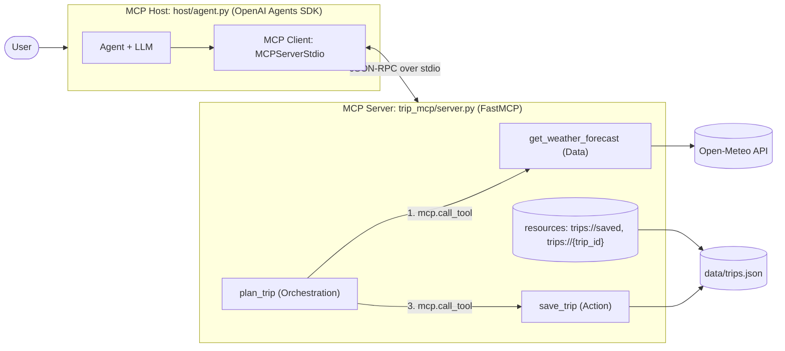

# Weather & Trip Planner: an MCP toolkit with FastMCP and the OpenAI Agents SDK

EECE 503P/798S Agentic Systems, assignment C5 (Agent Tools).

A small MCP server built with **FastMCP** exposes exactly **three tools**: one Data tool, one Action tool and one Orchestration tool. An agent built with the **OpenAI Agents SDK** acts as the MCP host/client and routes user requests to them. Weather comes from [Open-Meteo](https://open-meteo.com/), which needs no API key.

| Deliverable | Where |
|---|---|
| Written summary (Part 1) | [summary.md](summary.md) |
| FastMCP server (3 tools + 2 resources) | [trip_mcp/server.py](trip_mcp/server.py) |
| Agents SDK host/client | [host/agent.py](host/agent.py) |
| Configuration and setup instructions | this README, [.env.example](.env.example) |
| Tests, including every failure case | [tests/](tests/) |
| Reflection | [reflection.md](reflection.md) |
| Screencast video | _add the unlisted YouTube link here_ |

## Architecture



- The **host** is the agent program. It owns the conversation and the LLM, and it decides which tool to call.
- The **client** (`MCPServerStdio`) launches the server as a subprocess and keeps one dedicated stdio connection to it.
- The **server** lists its tools to the client and executes the calls.

## The three tools

| Category | Tool | Purpose | Arguments → output | Predictable failures (clear error, never silent) |
|---|---|---|---|---|
| **Data** | `get_weather_forecast` | Look up the daily forecast for a city. Read-only. | `city: str`, `start_date: date = today`, `days: int (1–7) = 3` → `Forecast` | Unknown city; date in the past or beyond the 16-day window; `days` out of range; weather service timeout or 5xx (retried once first) |
| **Action** | `save_trip` | Save one trip to the trip store. | `city`, `start_date`, `end_date`, `notes: str = ""` → `SavedTrip` | `end_date` before `start_date`; duplicate trip; corrupt or unwritable store (left untouched) |
| **Orchestration** | `plan_trip` | Create a saved, weather-aware trip plan. | `city`, `start_date`, `days (1–7) = 3` → `TripPlan` | Step 1 fails → *"stopped at step 1 … Nothing was saved."*; step 3 fails → *"got the forecast, but step 3 (save_trip) failed …"* |

How the tools are put together:
- **Orchestration:** `plan_trip` calls the two registered tools through the server with `await mcp.call_tool(...)`. It gets the same validation and errors the agent would get, and it never duplicates their logic. Step 2 combines the forecast into a summary and a packing list using the pure helpers in `trip_mcp/planning.py`.
- **Documentation:** every argument has a type and a description (`Annotated[..., Field(...)]`). Every output is a Pydantic model, so clients receive an output schema.
- **MCP annotations:** each tool marks its category. The Data tool is `readOnlyHint=True`; the Action and Orchestration tools are `readOnlyHint=False` and `destructiveHint=False`.
- **Resources:** two read-only `@mcp.resource` lookups, `trips://saved` and `trips://{trip_id}`. They are not tools, so the server still has exactly three tools.

## Setup

Requirements: Python 3.11+ and [uv](https://docs.astral.sh/uv/). Tested on Windows 11 with Python 3.12, fastmcp 4.1.3, openai-agents 0.24.0 and mcp 2.3.0.

```bash
uv sync
```

```bash
cp .env.example .env
```

Then set `OPENAI_API_KEY` in `.env`. Only the live agent needs it; the tests don't. Optional settings: `OPENAI_DEFAULT_MODEL` (the SDK default is `gpt-5.6-luna`) and `TRIPS_FILE` (default `data/trips.json`).

## Run

Interactive agent. Commands: `/tools`, `/trips`, `/reset`, `/quit`.

```bash
uv run python -m host.agent
```

One question, then exit:

```bash
uv run python -m host.agent "Plan a 3-day trip to Paris, France starting next Monday"
```

Example prompts: "What's the weather in Beirut for the next 3 days?" (Data tool), "Save a trip to Byblos for this Saturday and Sunday" (Action tool), "Plan a 3-day trip to Paris, France starting next Monday" (Orchestration tool), "Plan a 2-day trip to Xyzzyville starting next Saturday" (failure: unknown city, nothing saved).

Each agent turn prints the round trip: `host -> MCP client -> server` lines from the host's `RunHooks`, `[server]` lines from the server's stderr log, and a link to the run's trace on the OpenAI dashboard.

Other ways to run the server:

| Purpose | Command |
|---|---|
| Server alone over stdio | `uv run python -m trip_mcp.server` |
| Server over Streamable HTTP | `uv run python -m trip_mcp.server --http --port 8000` (endpoint `http://127.0.0.1:8000/mcp`) |
| List the server's tools from the command line | `uv run fastmcp list trip_mcp/server.py` |
| Call one tool from the command line (shows the unknown-city error) | `uv run fastmcp call trip_mcp/server.py get_weather_forecast city=Xyzzyville` |

## Tests

Offline suite (31 tests). The network is mocked and each test uses its own temporary trip store:

```bash
uv run pytest -v
```

Optional checks against the real Open-Meteo API:

```bash
uv run pytest -m live
```

| File | What it covers |
|---|---|
| `tests/test_tools.py` | Exactly three tools, with descriptions, typed schemas and annotations; each tool's happy path and **each failure case**; the orchestrator saving nothing when step 1 fails; both resources |
| `tests/test_planning.py` | Packing-list and summary rules |
| `tests/test_host.py` | The Agents SDK's `MCPServerStdio` against the real server subprocess, plus a full **agent → MCP client → server → agent** round trip. A scripted stand-in model replaces the LLM, so no API key is needed. |
| `tests/test_live_api.py` | Opt-in live API checks |

## Project layout

```
trip_mcp/            MCP server package
  server.py          FastMCP server: 3 tools, 2 resources, stdio/HTTP entry point
  models.py          Pydantic input/output models (tool output schemas)
  weather.py         Open-Meteo geocoding + forecast client (timeouts, one retry, clear errors)
  storage.py         JSON trip store (atomic writes, duplicate and corruption checks)
  planning.py        Pure helpers: packing list and summary
host/agent.py        MCP host: Agents SDK agent, MCPServerStdio client, round-trip logging, chat loop
tests/               pytest suite (31 offline tests + 2 opt-in live tests)
summary.md           Part 1 written summary
reflection.md        Reflection
```

## Attribution

Weather data by [Open-Meteo.com](https://open-meteo.com/), licensed [CC BY 4.0](https://creativecommons.org/licenses/by/4.0/). Free for non-commercial use.
